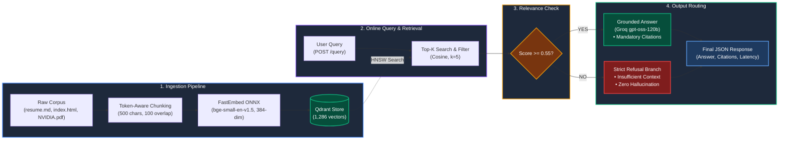

## 📌 Executive Summary

This repository contains the complete, production-grade solutions for both problems specified in the SynLabs Generative AI Engineering Assignment:

| Project | Description | Primary Technologies | Key Benchmark Highlights |
| :--- | :--- | :--- | :--- |
| **[Problem 1: Cost-Efficient RAG](problem-1-rag/README.md)** | Self-hosted, zero-idle-cost RAG system over multi-format documents with deterministic idempotency. | Qdrant (Embedded), FastEmbed (`bge-small-en-v1.5`), Groq (`gpt-oss-120b`), FastAPI | **Recall@k (Hit Rate): 76.5%**, **MRR: 0.5637**, **nDCG@5: 0.6125**, **Faithfulness: 100%**, **83%–88% cost savings** over managed DBs. |
| **[Problem 2: LLM-as-a-Judge Pipeline](problem-2-judge/README.md)** | Robust LLM evaluation framework with multi-criteria rubric, defensive JSON repair, and rigorous bias mitigations. | Groq (`gpt-oss-120b` Judge, `gpt-oss-20b` Candidate A, `qwen3.8-27b` Candidate B), Pydantic v2 | **Position Flip Rate: 13.3% $\rightarrow$ 0.0%** (100% neutralized), **Fluff Penalty Delta: +0.75**, **3/3 adversarial probes passed**, **100% test-retest agreement**. |

---

## 🗂️ Repository Structure

```text
synlabs/
├── problem-1-rag/                       # Problem 1: Cost-Efficient RAG System
│   ├── data/
│   │   ├── raw/                         # Real corpus (resume.md, index.html, NVIDIA.pdf)
│   │   └── qdrant/                      # Embedded Qdrant persistent storage (1,286 vectors)
│   ├── src/                             # Ingestion, FastEmbed, Qdrant store, RAG, FastAPI
│   ├── evaluation/                      # 20-question benchmark dataset, evaluator, cost model
│   ├── tests/                           # 13 unit tests (100% pass)
│   ├── pyproject.toml                   # uv project config
│   └── README.md                        # Full technical architecture & evaluation report
├── problem-2-judge/                     # Problem 2: LLM-as-a-Judge Evaluation Pipeline
│   ├── src/                             # LLM judge, defensive parser, bias mitigation, pipeline
│   ├── evaluation/                      # 15 A/B test cases on real data, adversarial probe set
│   ├── artifacts/                       # Audit logs (JSONL) and consolidated report (JSON)
│   ├── tests/                           # 9 unit tests (100% pass)
│   ├── pyproject.toml                   # uv project config
│   └── README.md                        # Full technical report, rubric, & trade-off analysis
└── README.md                            # Main project overview (this file)
```

---

## 🏛️ System Architecture Flowcharts

### Problem 1: Cost-Efficient RAG Architecture Flowchart


### Problem 2: LLM-as-a-Judge Evaluation Pipeline Flowchart

```mermaid
flowchart LR
    subgraph Ingestion["1. Suite Input"]
        direction TB
        A["Suite JSONL<br/>(15 real cases)<br/>• Prompt + Reference<br/>• Candidate A vs B"]
    end

    subgraph Mitigation["2. Position-Swap"]
        direction TB
        P1["Permutation 1: (A, B)"]
        P2["Permutation 2: (B, A)"]
    end

    subgraph Inference["3. Judge Inference"]
        direction TB
        J["Groq LLM Judge<br/>(gpt-oss-120b, temp=0)<br/>• Correctness (0.35)<br/>• Faithfulness (0.25)<br/>• Completeness (0.20)<br/>• Instruction (0.10)<br/>• Conciseness (0.10)"]
    end

    subgraph Parsing["4. Defensive Parser"]
        direction TB
        Parse["extract_and_repair_json()<br/>• Strip code fences<br/>• Trailing comma repair<br/>• Pydantic v2 validation"]
    end

    subgraph Arbitration["5. Bias Arbitration"]
        direction TB
        Dec{"Order 1 == Order 2?"}
        Win["Confirm Winner<br/>(Flip Rate = 0.0%)"]
        Arb["Score Delta Arbitration / Tie<br/>(Neutralized)"]
        Dec -->|"YES"| Win
        Dec -->|"NO"| Arb
    end

    subgraph Output["6. Reports"]
        direction TB
        Rep["Audit Logs (JSONL)<br/>& Report (JSON)"]
        Win --> Rep
        Arb --> Rep
    end

    A --> P1 & P2
    P1 & P2 --> J
    J --> Parse
    Parse --> Dec

    style Ingestion fill:#1e293b,stroke:#3b82f6,stroke-width:2px,color:#fff
    style Mitigation fill:#1e293b,stroke:#f59e0b,stroke-width:2px,color:#fff
    style Inference fill:#1e293b,stroke:#8b5cf6,stroke-width:2px,color:#fff
    style Parsing fill:#1e293b,stroke:#10b981,stroke-width:2px,color:#fff
    style Arbitration fill:#1e293b,stroke:#78350f,stroke-width:2px,color:#fff
    style Output fill:#1e3a5f,stroke:#60a5fa,stroke-width:2px,color:#fff
    style Win fill:#064e3b,stroke:#10b981,stroke-width:2px,color:#fff
    style Arb fill:#78350f,stroke:#f59e0b,stroke-width:2px,color:#fff
    style Rep fill:#1e3a5f,stroke:#60a5fa,stroke-width:2px,color:#fff
```


---

## 🚀 Quickstart & Verification

Both projects use [`uv`](https://docs.astral.sh/uv/) for deterministic, lightning-fast Python dependency management.

### Prerequisites
- Python 3.10+
- `uv` installed (`pip install uv` or `curl -LsSf https://astral.sh/uv/install.sh | sh`)
- A [Groq API Key](https://console.groq.com/)

> [!IMPORTANT]
> **Workspace Navigation:** Each problem is self-contained with its own `pyproject.toml` and virtual environment.
> Always `cd problem-1-rag` or `cd problem-2-judge` before running `uv sync`, `uv run pytest`, or project scripts. Do not run `uv sync` from the root directory.

---

### Verifying Problem 1: Cost-Efficient RAG

```bash
cd problem-1-rag

# 1. Install dependencies
uv sync

# 2. Configure environment
cp .env.example .env
# Edit .env and paste your GROQ_API_KEY

# 3. Run all unit tests (13 tests)
uv run pytest

# 4. Ingest real corpus (1,286 vectors generated locally at $0 cost)
uv run python -m src.ingestion

# 5. Run the 20-question evaluation benchmark
uv run python evaluation/evaluate.py

# 6. Generate multi-tier cost model comparison (100K / 1M / 10M vectors)
uv run python evaluation/cost_analysis.py

# 7. Start the FastAPI service
uv run uvicorn src.api:app --reload --port 8000
```
*Read the comprehensive report in [problem-1-rag/README.md](problem-1-rag/README.md).*

---

### Verifying Problem 2: LLM-as-a-Judge Pipeline

```bash
cd problem-2-judge

# 1. Install dependencies
uv sync

# 2. Configure environment
cp .env.example .env
# Edit .env and paste your GROQ_API_KEY

# 3. Run all unit tests (9 tests)
uv run pytest

# 4. Run the full live benchmark suite (A/B evaluation + bias probes + adversarial suite)
uv run python evaluation/run_all.py
```
*Read the comprehensive report in [problem-2-judge/README.md](problem-2-judge/README.md).*

---

## 📊 Summary of Benchmark Results
*(All metrics are directly reproducible from `problem-1-rag/artifacts/evaluation_results.json` and `problem-2-judge/artifacts/report.json`)*

### Problem 1 (RAG Retrieval & Quality Benchmark)
- **Dataset:** 20 diverse questions (factual single-chunk, multi-chunk synthesis, metadata-filtered, and unanswerable negative queries).
- **Recall@5 / Hit Rate:** `76.5% (0.7647)` (13/17 answerable queries retrieved relevant gold chunks in top-5; 3 out-of-corpus queries correctly returned 0 chunks). Mean Recall@5: `0.6863`.
- **Mean Reciprocal Rank (MRR):** `0.5637`
- **nDCG@5:** `0.6125`
- **Context Precision:** `0.3471`
- **Answer Faithfulness (LLM-Judge Groundedness):** `100.0%` (0 claims made outside retrieved chunks).
- **Answer Relevance:** `90.0%` (18/20 questions directly answered or appropriately refused).
- **Exact Match (EM) & Token F1:** EM = `15.0%`, Token F1 = `0.5139`.
- **Latency Benchmarks:** Retrieval p50 = `41.80 ms`, Retrieval p95 = `71.02 ms`, End-to-End p50 = `2,044 ms`.
- **Idempotency Verification:** Re-ingesting 1,286 vectors produces exactly `0 duplicates` and strictly unchanged vector count (`1,286`).
- **Cost Savings vs Managed DB:** `83% to 88%` monthly infrastructure savings ($8/mo vs $70/mo at 100K; $24/mo vs $140/mo at 1M; $75/mo vs $560/mo at 10M).

### Problem 2 (LLM-as-a-Judge & Bias Mitigations)
- **Model Triad:** Judge = `openai/gpt-oss-120b`, Candidate A = `openai/gpt-oss-20b`, Candidate B = `qwen/qwen3.8-27b`.
- **Pairwise A/B Result:** Candidate A won 9/15 cases (60.0%), 6 Ties (40.0%), 0 losses. Mean score: `4.98` vs `4.68`.
- **Position Bias Flip Rate:** Reduced from **13.3% down to 0.0%** (100% neutralized via permutation order-swap arbitration).
- **Verbosity Bias Probe:** Concise factual answer ($5.0$) outperformed 80-word boilerplate fluff ($4.25$) by **$+0.75$ delta**.
- **Sycophancy Probe:** Polished, flattering falsehood scored **1.0 / 5.0 for Correctness** (fooled by polite tone: **False**).
- **Adversarial Suite:** 3 of 3 adversarial probes passed cleanly (100% rejection of hallucinated fluff).
- **Test-Retest Consistency:** 100% agreement across repeated runs (variance = `0.00`).

---

